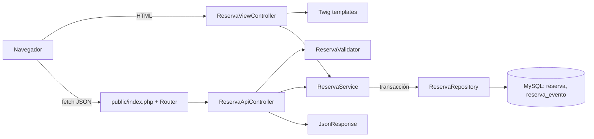

# Continuidad — Prueba técnica PHP Junior · MisterPlan

> **Última actualización:** 17/10/2026 · **Fase actual:** cierre de la Fase 1 (auditoría y plan aprobado). **No existe código de la aplicación.**
> Este documento sirve para retomar el proyecto en otra sesión sin repetir la investigación. Si algo de aquí contradice al código, **manda el código**.

---

## 1. Contexto y objetivo

- **Empresa:** MisterPlan, empresa española de software turístico. **Puesto:** Desarrollador/a Junior PHP. El trabajo es presencial en Cáceres durante los primeros meses.
- **Objetivo:** desarrollar una aplicación de **gestión de reservas de alojamiento** que incluya:
  1. una API JSON en PHP nativo;
  2. vistas renderizadas en servidor con Twig;
  3. una interfaz con HTML, CSS y JavaScript que use la API sin recargar la página.
- **Prioridad de evaluación:** backend y seguridad, por delante del diseño visual.
- **Objetivo personal:** entender y poder **defender** cada decisión en la entrevista.

### Fuentes disponibles y limitaciones

| Fuente | Disponible | Nota |
|---|---|---|
| Enunciado original de MisterPlan (PDF o correo) | ❌ **No** | El enunciado se ha reconstruido a partir de la descripción del Project de claude.ai y del «Prompt maestro» redactado por Coral. **Hay que contrastarlo con el original.** |
| Descripción del Project «Prueba técnica MisterPlan» | ✅ | Es la fuente principal de requisitos. |
| Prompt maestro de desarrollo, por fases | ✅ | Define la forma de trabajo y los criterios de aceptación. |
| Conversación «Respuesta oferta Junior PHP» | ✅, resumen | Contiene la respuesta a Arturo, el recruiter, y confirma la presencialidad en Cáceres. |
| Repositorio en GitHub `coralormad/pruebatecnicaMP` | ✅ | Está vinculado al Project. Solo contiene un `README.md` con el título. |
| Carpeta local del proyecto | ❌ | Todavía no está conectada a Claude. El estado se ha verificado con las salidas de terminal que pegó Coral. |

---

## 2. Requisitos (resumen verificable)

### Tecnologías y restricciones

- PHP nativo, **sin Laravel ni Symfony**.
- MySQL o MariaDB, con PDO y consultas preparadas.
- **Twig es obligatorio.**
- HTML semántico, CSS responsive y JavaScript vanilla. Se puede usar jQuery solo si está justificado.
- Composer y, si aplica, PHPUnit.
- Git y GitHub, con **commits pequeños y reales**.
- Despliegue con una **URL pública verificada**.
- Archivo SQL importable con DDL y datos de ejemplo.
- README completo, incluido el análisis de **1.000 reservas por hora**.

### Modelo de datos

- **`reserva`**:
  - `id`
  - `nombre_huesped`
  - `email_huesped`
  - `nombre_alojamiento`
  - `fecha_entrada`
  - `fecha_salida`
  - `estado`: `pendiente`, `confirmada` o `cancelada`
  - `importe`
  - `notas`
  - `fecha_creacion`
- **`reserva_evento`**:
  - `id`
  - `reserva_id` como clave foránea
  - `tipo`
  - `descripcion`
  - `fecha_creacion`
- Debe registrarse un evento al **crear una reserva** y en cada **cambio de estado válido**.
- La reserva y su evento deben guardarse dentro de la **misma transacción**.

### API

| Método | Ruta | Función |
|---|---|---|
| GET | `/api/reservas` | Lista las reservas. Permite combinar filtros por estado, fechas y nombre del huésped. |
| GET | `/api/reservas/{id}` | Devuelve el detalle de una reserva y, previsiblemente, su historial. |
| POST | `/api/reservas` | Crea una reserva y devuelve **201**. |
| PATCH | `/api/reservas/{id}/estado` | Cambia el estado a `confirmada` o `cancelada`. |

Códigos HTTP previstos: 200, 201, 400, 404, 405, 409, 422 y 500. **No se deben exponer trazas, SQL ni credenciales.**

### Vistas Twig

- **Listado:**
  - tabla responsive;
  - filtros;
  - enlace al detalle;
  - acción para cancelar;
  - estados visuales.
- **Detalle:**
  - datos completos;
  - historial en forma de línea temporal.
- Uso de una **plantilla base** con `extends` y `block`.
- Autoescape activo y **sin usar `|raw`**.

### JavaScript

La interfaz debe permitir:

- filtrar sin recargar la página;
- crear reservas mediante un formulario;
- validar en cliente;
- mostrar los errores devueltos por la API;
- cancelar con confirmación;
- mostrar estados de carga y mensajes;
- gestionar errores de red, respuestas no correctas y JSON inválido.

El JavaScript debe estar en archivos independientes y **sin manejadores inline**.

---

## 3. Estado real del proyecto

| Elemento | Estado | Evidencia |
|---|---|---|
| Código de la aplicación | **No existe** | `git status` muestra «No commits yet» y que no hay nada que confirmar. |
| Repositorio local | En `C:\dev\pruebatecnicaMP` | Coral indica que lo movió desde OneDrive. **Pendiente:** comprobar `git status` y `git remote -v` en la nueva ruta. |
| Rama | `main`, sin commits | Salida de `git status` antes del traslado. |
| Remoto | `https://github.com/coralormad/pruebatecnicaMP.git` | Se clonó desde ahí. El Project también está sincronizado con ese repositorio. |

---

## 4. Entorno local verificado

| Herramienta | Versión o ubicación | Estado |
|---|---|---|
| PHP CLI | 8.3.6 de WAMP: `C:\wamp64\bin\php\php8.3.6\php.exe` | ✅ Incluye `pdo_mysql`, `mbstring`, `intl`, `json`, `openssl`, `zip`, `curl` y Xdebug 3.3.2. |
| Composer | 2.10.3, en `C:\ProgramData\ComposerSetup\bin` | ✅ Usa PHP 8.3.6. |
| Base de datos | **MySQL 8.3.0 de WAMP**, servicio `wampmysqld64`, **puerto 3306** | ✅ `root` sin contraseña, solo en local. |
| Git | 2.55.0 | ✅ |
| Terminal principal | Git Bash | `~/.bashrc` añade al `PATH` PHP 8.3.6 y `C:\wamp64\bin\mysql\mysql8.3.0\bin`. |

### Problemas resueltos durante la auditoría

1. Al **`PATH` del sistema le faltaban las rutas de Windows**, incluida `System32`. Se repararon con PowerShell como administrador. La copia de seguridad está en `C:\Users\coral\path-sistema-backup.txt`.
2. Composer no estaba instalado. El instalador había propuesto **PHP 7.4**, pero se corrigió para usar **8.3.6**. También se desmarcó una opción de proxy vacía.
3. Había **tres servidores de base de datos** en el equipo:
   - **MySQL82**, una instalación independiente de MySQL 8.2 cuya contraseña de `root` se desconoce. Había dos instancias en conflicto. Ahora está **detenido y con arranque manual**. Sus datos no se han borrado.
   - **MariaDB 10.4 de XAMPP** en el puerto **3308**. Contiene bases de datos de proyectos anteriores, como `pac1s2425` y `tfg_tattoo`. **No debe usarse ni modificarse.**
   - **MySQL 8.3 de WAMP** en el puerto **3306**. ✅ **Es el servidor elegido.**

### Advertencias para no volver a equivocarse

- Los comandos de **PowerShell** (`Get-*`, `Stop-Service`, etc.) **no funcionan en Git Bash**. Para ejecutarlos con permisos de administrador desde Git Bash, se usa:
  `powershell.exe -Command "Start-Process powershell -Verb RunAs -ArgumentList '-NoExit','-ExecutionPolicy','Bypass','-File','C:\Users\coral\script.ps1'"`
  Existe un script de ejemplo en `~/cambiar-a-wamp-mysql.ps1`.
- Los comandos deben pegarse **de uno en uno** si van en líneas separadas.
- Si Workbench tiene configurada la conexión «Local instance MySQL82», apunta al servidor detenido. Habrá que crear una conexión nueva a `127.0.0.1:3306` con `root`.

---

## 5. Decisiones técnicas confirmadas por Coral

| ID | Decisión | Motivo | Alternativa descartada |
|---|---|---|---|
| E1 | Usar WAMP para PHP 8.3 y MySQL 8.3 | Es el entorno más parecido a un hosting típico. La MariaDB 10.4 de XAMPP ya no tiene soporte. | XAMPP o reparar MySQL82 |
| E2 | Desarrollar con `php -S localhost:8000 -t public`, sin Apache | Evita configurar virtual hosts en local. | Apache de WAMP |
| E3 | Mover el proyecto fuera de OneDrive | OneDrive puede bloquear archivos de `vendor/` y `.git/`. | Mantenerlo en OneDrive |
| D1 | Transiciones permitidas: `pendiente → confirmada`, `pendiente → cancelada` y `confirmada → cancelada`. `cancelada` es un estado final. Si se intenta cambiar al mismo estado o hacer una transición inválida, se devuelve **409**. | Evita estados incoherentes y deja clara la diferencia entre un dato inválido y un conflicto de estado. | Permitir cualquier cambio |
| D2 | **400** para peticiones que no se pueden interpretar, como JSON mal formado, un `id` no numérico o un filtro con formato incorrecto. **422** para datos con formato correcto que incumplen las reglas, como un email inválido o una fecha de salida anterior a la de entrada. | Distingue errores de formato y errores de validación. | Usar solo 400 |
| D3 | `fecha_entrada=AAAA-MM-DD` filtra por igualdad exacta. `desde` y `hasta` filtran por **solapamiento**: `fecha_entrada <= hasta AND fecha_salida > desde`. | El día de salida no se considera una noche ocupada. | Usar solo la fecha de entrada |
| D4 | Configuración en `.env` leída con `parse_ini_file()`, sin librerías | Basta para el alcance de la prueba y es fácil de explicar. | `vlucas/phpdotenv` |
| D5 | Usar `DECIMAL(10,2)`, `ENUM` para el estado, `CHECK (fecha_salida > fecha_entrada)`, `utf8mb4` e índices | Evita errores de precisión con importes y añade integridad en la propia base de datos. El SQL debe ser compatible con MySQL 8 y MariaDB. | `FLOAT` o `VARCHAR` libre |
| D6 | Crear el usuario `misterplan_app` con permisos solo sobre la base de datos `misterplan` | Aplica el principio de mínimo privilegio. | Conectar como `root` |
| D7 | Usar PHPUnit 11 con tests unitarios del validador y tests de integración contra `misterplan_test` | Permite probar la lógica sin afectar a los datos de desarrollo. | Hacer solo pruebas manuales |

---

## 6. Arquitectura prevista (aprobada, no implementada)

```
public/        index.php (front controller), .htaccess, assets/{css,js}
src/           Database.php · Http/{Router,Request,JsonResponse}
               Controller/{ReservaApiController,ReservaViewController}
               Service/ReservaService · Repository/ReservaRepository
               Validation/ReservaValidator · Exception/{Validation,NotFound,Conflict}Exception
templates/     base.html.twig · reservas/{listado,detalle}.html.twig
database/      reservas.sql
tests/         Unit/ · Integration/
.env.example   composer.json · phpunit.xml · .gitignore · README.md
```



---

## 7. Plan y estado de las fases

| Fase | Contenido | Estado |
|---|---|---|
| 1 | Auditoría y plan | ✅ Completada y aprobada el 17/10 |
| 2 | Estructura, `composer.json`, `.gitignore`, `.env.example` y SQL | ⏭ Siguiente |
| 3 | PDO, repositorio, servicio y transacciones | Pendiente |
| 4 | API, validación y errores | Pendiente |
| 5 | PHPUnit y revisión de seguridad | Pendiente |
| 6 | Twig: listado y detalle | Pendiente |
| 7 | JavaScript: filtros, creación y cancelación | Pendiente |
| 8 | Revisión completa y README | Pendiente |
| 9 | Despliegue verificado, escalabilidad y preparación de la entrevista | Pendiente |

---

## 8. Próximos pasos (en orden)

1. Comprobar el repositorio en la nueva ruta con:
   ```bash
   cd /c/dev/pruebatecnicaMP && git status && git remote -v
   ```
2. Decidir la forma de trabajo:
   - **a)** conectar la carpeta a Claude mediante «+» → «Add folder»;
   - **b)** que Claude envíe bloques de código y Coral cree los archivos.
3. Fase 2:
   - crear la base de datos `misterplan` y el usuario `misterplan_app`;
   - crear la estructura del proyecto;
   - configurar `composer.json` con autoload PSR-4 `App\` y Twig;
   - crear `database/reservas.sql`.
   - Commits previstos: `chore: initialize project structure` y `feat: add reservation database schema`.
4. Contrastar estos requisitos con el **enunciado original** de MisterPlan.

## 9. Instrucciones para retomar en otra sesión

- Leer este archivo y la descripción del Project antes de proponer cambios.
- Trabajar **una fase cada vez** y esperar la aprobación de Coral antes de avanzar.
- Explicar todo el código para que pueda defenderlo en la entrevista.
- Usar los prefijos 💻, 📄 y ✏️, e indicar siempre las rutas exactas.
- No hacer commits, pushes ni operaciones destructivas sin aprobación.
- No afirmar que un test o un despliegue funciona sin haberlo ejecutado y comprobado.
- **Preparación de la entrevista:** se completará en la Fase 9, cuando exista código real que defender. Antes de esa fase, solo se pueden defender las decisiones de entorno y de diseño de las secciones 4 y 5.

## 10. Registro de cambios

- **14–15/10/2026:**
  - repositorio creado y clonado;
  - auditoría del entorno;
  - `PATH` reparado;
  - Composer instalado.
- **15/10/2026:**
  - diagnóstico de MySQL82: contraseña desconocida y dos instancias en conflicto.
- **17/10/2026:**
  - cambio a MySQL 8.3 de WAMP;
  - Fase 1 aprobada con las decisiones D1–D7;
  - proyecto movido a `C:\dev\pruebatecnicaMP`;
  - creación de este documento.
